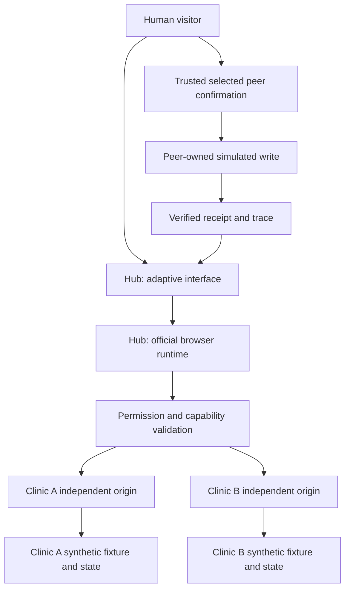

# Architecture — proposed, not implemented

The official browser runtime is the source of truth for network execution. Use its published manifest/network schema and reference peer mechanisms. Pin and inspect the actual implementation before deciding file names or APIs.

## System boundaries

The graph is conceptual, not evidence of implementation. Peer network execution in the caller browser must not be confused with sending all reasoning to a remotely hosted agent. Follow pinned upstream behavior.

## Ownership and trust

| Component | Owns | Does not own |
|---|---|---|
| Hub | Session, preference validation, peer permission, comparison, trusted proposal and trace | Peer booking inventory, private patient records |
| Clinic A/B | Independent fixtures, site actions, state, confirmation and receipt | Hub session internals, other clinic state |
| LLM | Reasoning and constrained view/tool selection | Authorization, verified data, booking truth |
| UI renderer | Render allowed components and dispatch bounded intent | Arbitrary executable content or write authorization |

## Flow

1. Validate visitor preferences, confirm demo disclosure.
2. Show exact peer origin and shared data scope before loading/calling peer network.
3. Collect actual peer responses; validate schema, freshness, provenance; keep partial failures visible.
4. Render comparison from returned values, preserving origin and slot identity.
5. Visitor selects a slot. Build immutable, expiring proposal; display trusted peer-origin approval.
6. Cancel performs no write. Confirm once; validate origin/session/slot/expiry and replay protection.
7. Selected peer returns authoritative receipt; show success only from verified response.

## Deployment and dependencies

Three independently deployable HTTPS websites, initially proposed on Vercel; actual domains TBD. Static-first architecture with narrowly scoped provider proxy only if needed. No custom agent backend, CRM, auth SaaS or database unless a documented reliability blocker makes it necessary. Use native adaptive UI before optional SDKs. Node/TypeScript only after upstream reproduction.

Proposed future layout: apps/hub, apps/clinic-a, apps/clinic-b, packages/domain, packages/ui-adapter, tests. Optional adapters must be feature-gated. None of these application folders exists yet.

See [PRD](PRD-v2.md) and [protocol matrix](PROTOCOLS.md) for the full constraints.
